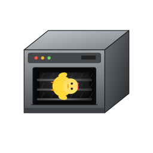

# iWuji

[English](./README.en.md) · **简体中文**


> 一个零依赖、纯前端的**网页手机操作系统(WujiOS)**和**网页电脑操作系统(ZhuziOS)**。打开浏览器就能玩：拟真手机外壳、桌面、通知与控制中心、主题、文件管理、应用商店，以及 40+ 个小应用。还能用 **iWuji Studio** 自己写应用装进去。

原生 **HTML / CSS / JavaScript**，没有构建步骤、没有 `node_modules`、没有框架。所有应用都是普通的 `.js` 文件，通过 `WujiApps.register({...})` 注册进系统。


## 在线体验

- iWuji(网页手机/iWuji操作系统)：<https://zhuziexe.github.io/iwuji/>
- ZhuziOS(网页电脑操作系统)：<https://zhuziexe.github.io/iwuji/zhuzios.html>

🎈 直接点击上面的链接就可以在线体验


## 本地运行

<table>
  <tr>
    <td width="256" valign="middle">
      
    </td>
    <td>

> ⚠️ **请不要直接双击 `index.html` 用 `file://` 打开。**
> 应用商店清单（`store/apps.json`）、商城商品、餐饮数据以及安装应用时的源码都通过 `fetch()` 加载，`file://` 协议会被浏览器 CORS 策略拦截，导致商店为空、应用装不上。**直接双击打开，小鸡会被烤。** 请用任意本地 HTTP 服务器：
请用任意本地 HTTP 服务器：

```bash
# Python
python -m http.server 8080

# 或 Node.js
npx serve .
```

然后浏览器访问 <http://localhost:8080/> 即可。
    </td>
  </tr>
</table>


> 部分能力依赖浏览器权限或安全上下文：定位、相机/麦克风、电量、真实地图瓦片等需要 **HTTPS 或 localhost**，首次使用会弹出授权提示；不支持的浏览器会自动回退为模拟数据。


## 入口文件

| 文件 | 作用 |
| --- | --- |
| `index.html` | **iWuji手机模拟器** 手机外壳（边框、侧键、全屏），内部用 iframe 加载 OS，日常使用 |
| `wujios.html` | WujiOS 主系统，不要直接打开 |
| `zhuzios.html` | **ZhuziOS电脑模拟器** 日常使用 |
| `phone.html` | 独立电话页面 |
| `studio.html` | **iWuji Studio**，可视化编写 / 打包自己的应用 |


## 能玩什么

**系统级**：桌面与分页、图标拖拽、通知中心、控制中心（亮度/音量/不息屏等）、深浅色主题、文件系统、备份与恢复、应用安装器与商店、状态栏真实电量、开发者选项(连续点击版本号7次)。

**内置应用**：计算器、相机、时钟、文件预览、文件管理、电话、相册、设置、任务管理器、主题、天气、图库。

**商店应用**：牛奶地图、地铁图 / 开地铁、吴际MC、备忘录、音乐、电台、吴际哔哩、AI 新闻、百科、股票、今天吃什么等。

> 去应用市场下载**吴际小鸡**，就能养一只这样的小鸡:
<p>
  
  
  
</p>

## 用 Studio 写一个应用

打开 `studio.html`，填好应用信息、写 HTML/CSS/JS，即可导出并安装到系统里。应用本质上就是一个调用 `WujiApps.register()` 的 JS 文件：

```js
WujiApps.register({
  bundlename: 'com.example.helloworld',
  name: '你好世界',
  icon: './assets/app.svg',
  initialRoute: 'main',
  styles: `.hello { padding: 40px; }`,
  routes: {
    main: {
      name: 'main',
      render() {
        return `<div class="hello"><h1>Hello, iWuji!</h1></div>`;
      }
    }
  }
});
```

- 应用放在 `store-apps/`，在 `store/apps.json` 里登记 `bundle / name / icon / version / author / description / src`；
- 图标放在 `assets/`，主题在 `themes/`。


## 目录结构

```
.
├── index.html            # 手机外壳 + iframe 入口
├── wujios.html           # WujiOS 主系统
├── niubeeos.html         # 其他 OS 皮肤
├── zhuzios.html
├── phone.html            # 独立电话
├── studio.html           # iWuji Studio
├── core.js               # 应用注册表 + 系统级存储
├── app-loader.js / installer.js / app-storage.js / app-code-store.js
├── builtin-apps.js       # 内置应用清单
├── control-center.js / notification.js / panelsystem.js / overlay.js
├── theme.js / desktop-layout.js / navigation.js / device-compat.js
├── fs.js / fs-worker.js / backup.js / file-opener.js / dialog.js / toast.js
├── manual.js             # 说明书
├── apps/                 # 内置应用
├── store-apps/           # 商店应用（30+）
├── store/apps.json       # 应用商店清单
├── assets/               # 图标与图片
├── styles/               # 系统样式（os.css / tokens.css 等）
├── themes/               # 主题
├── scripts/              # 辅助脚本（每日刷新商城库存）
└── .github/workflows/    # GitHub Actions 定时任务
```


## 兼容性

面向现代 Chromium / Firefox / Safari。建议使用最新版桌面 Chrome / Edge 或手机浏览器。`getBattery`、`wakeLock` 等在部分浏览器不可用时会自动降级为模拟值；涉及摄像头、定位的功能需要用户授权。


## 说明

这是一个兴趣向的玩具项目，用来折腾前端与「OS 感」交互，不是真正的操作系统，也不适配生产环境。应用里的天气、新闻、地图等数据来自第三方公开服务，可用性取决于对应服务。

欢迎提 Issue / PR，尤其是新的小应用 😄
